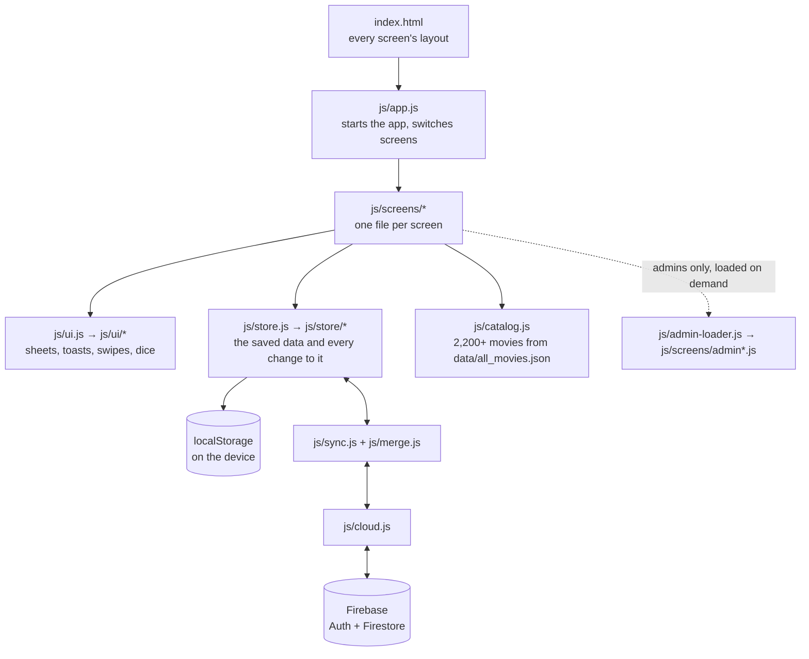

# Roll Credits: Developer Guide

How the app is built, how to run it, and how the data works. For what the app is and how to use it, see `README.md`.

Roll dice to pick tonight's movie. Each **film festival** (Halloween, Christmas, Awards Season, Kids & Family,
Bucket List Cinema, or one you make) has its own tables, dice, and rating icon. Colors are one app-wide theme
(Settings → Themes). Plain HTML, CSS, and JavaScript: no framework, no build step. The browser runs the files in
this repo exactly as they are.

## Run it on your computer

```
python3 -m http.server 8000
```

Then open http://localhost:8000. (The JS loads as modules, which don't run from a double-clicked file.)

## How the app fits together



The rule that keeps it simple: **screens never change data directly.** They call a function in the store
(`store.watchMovie(...)`, `store.setSlot(...)`), and the store saves. Then the screen redraws itself from the
store. Sync listens for saves and backs them up to the account; nothing else has to know it exists.

### Folders

| Where | What's there |
|---|---|
| `index.html` | The layout of every screen and the tab bar. Screens fill in their content from JavaScript |
| `css/` | Styles, split by what they style and loaded in this order: `base` (colors, fonts, resets), `layout` (app frame, top and tab bars), `components` (buttons, cards, forms, sheets), `movie` (details, scare factor, where to watch), `roll` (dice, roll card, Popcorn Pick), `screens` (everything else), `admin`. Each file starts with a list of its sections |
| `js/app.js` | Starts the app: loads the data, wires up the tabs, starts sync, the catalog, and offline support |
| `js/store.js` | The data. One import for screens; the parts live in `js/store/`: `state.js` (loading, saving, the account's copy, undo, backups), `festivals.js`, `history.js`, `migrate.js` (checking and upgrading old data), `constants.js` |
| `js/ui.js` | Shared screen helpers, from `js/ui/`: `dom.js` ($, navigation), `sheet.js` (bottom sheets and the iPhone keyboard), `toast.js`, `swipe.js`, `controls.js` (dice, rating icons, chips) |
| `js/util.js` | Small helpers that don't touch the page: escaping text, dates, safe device storage, reduced motion |
| `js/screens/` | One file per screen or sheet: `roll`, `watched`, `popcorn`, `settings`, `editor` + `tables` (Edit festival), `festivals` (the festival switcher), `creator`, `library`, `theme-picker`, `account`, `services`, `feedback`, `updates`. Admin Tools: `admin`, `admin-festivals`, `admin-movies`, `movie-edit` |
| `js/admin-loader.js` | Loads Admin Tools only when an admin opens them, so nobody else downloads that code |
| `js/defaults.js` | Built-in festivals, dice options, category colors, rating icons |
| `js/themes.js` | Every theme. See *Adding a theme* below |
| `js/catalog.js` | The movie catalog: search, title matching, franchises, moods |
| `js/movieinfo.js` | Posters, the movie details sheet, scare factor, and where-to-watch display |
| `js/streaming.js` | Where-to-watch data (`data/streaming/US.json`) and My Streaming Services |
| `js/sync.js`, `js/merge.js`, `js/cloud.js` | Accounts: keeping the device and the account in step, merging edits from two devices, Firebase calls |
| `js/official.js`, `js/movieedits.js` | Published official festivals and admin movie edits, cached for offline use |
| `js/tmdb.js`, `js/autofind.js` | TMDB search through the relay, and title suggestions under title boxes |
| `js/dice.js`, `js/dice3d.js`, `js/icons.js` | Fair random numbers and flat dice, optional 3D dice, SVG drawings |
| `js/tutorial.js`, `js/moodmatch.js`, `js/appconfig.js` | First-run tour, mood suggestions from TMDB keywords, loading the Firebase config |
| `sw.js` | Offline support. Lists the files saved at install (`FILES`) |
| `data/` | `all_movies.json` is what the app reads (built, don't hand-edit). `catalog/` holds its sources, `streaming/` the where-to-watch data, `scares/` reviewed scare scores, `additions/` hand-added movies |
| `tools/catalog.py` | The catalog tool (Python, no installs). See `CATALOG.md` |
| `worker/` | The Cloudflare Worker that keeps the TMDB key off the page. See `RELAY_SETUP.md` |
| `tests/` | Tests for everything that doesn't touch the page (see below) |
| `art/themes/` | Background art for themes |
| `vendor/` | Libraries copied in unmodified: Firebase JS SDK 12.19.0 (Apache 2.0), dice-box 1.1.4 (MIT). Each only downloads when it's used |
| `firestore.rules` | Database security rules. Paste into the Firebase console (Firestore → Rules) after any change |

### Code conventions

- **One job per file**, named for what it is (`festivals.js`, not `helpers2.js`). Each file opens with a comment
  saying what it does; each function with a non-obvious job has one line saying why.
- **Screens draw from data.** A screen's `render…()` builds its HTML from the store and wires up its buttons.
  After a change, redraw rather than patching the page by hand.
- **Buttons:** a list of similar items gets one listener on the list that reads the tapped item's `data-…`
  attribute (`data-act="watch"`, `data-id="…"`). A single button gets its own listener.
- **Escape everything a person typed** before it goes into HTML: `esc(title)`.
- **No dependencies in the app.** Libraries are copied into `vendor/` and loaded only when needed. `package.json`
  is only for developer tools.
- Formatting is automatic (`npm run format`), so nobody has to argue about spacing or quotes.

### Code tour

A good order to read the code in, or to walk someone through it:

1. `index.html` and `js/app.js`: what's on screen and how the app starts.
2. `js/screens/roll.js`: the core idea. A roll moves through steps (idle → rolling → result), and each step has
   its own small render function.
3. `js/store.js`, then `js/store/history.js`: how watching a movie becomes a saved history entry.
4. `js/merge.js` and `tests/merge.test.js`: how two devices' edits combine without losing either (the most
   interesting algorithm in the app, with tests that show each case).
5. `js/store/migrate.js`: how old saved data upgrades safely.
6. `css/base.css` and `js/themes.js`: how one set of variables gives 16 different looks.
7. `tools/catalog.py` and `.github/workflows/`: the nightly pipeline that keeps 2,200+ movies up to date.
8. `firestore.rules` and `worker/tmdb-relay.js`: what keeps people's data private and the TMDB key secret.

## Publishing an update

1. Make your changes.
2. If you added a new file under `js/`, add it to the `FILES` list in `sw.js` (Admin Tools files are listed in the
   comment below it instead).
3. Bump `CACHE_VERSION` in `sw.js` (`v40` → `v41`) and `APP_VERSION` in `js/sync.js`.
4. Run `npm run check`. Everything should pass.
5. `git add .`, `git commit -m "what changed"`, `git push`.

## Developer tools

The app needs nothing installed. These are for working on it, and need Node 20 or newer.

| Command | What it does |
|---|---|
| `npm test` | Runs the tests (no install needed: Node's built-in test runner) |
| `npm install` | Once, before the commands below: installs ESLint and Prettier into `node_modules/` (never committed) |
| `npm run lint` | ESLint: finds mistakes like a missing import or an unused variable (`eslint.config.js`) |
| `npm run format` | Prettier: formats every JS and CSS file the same way (`.prettierrc.json`) |
| `npm run check` | All three, without changing anything. Run before pushing |

## Running the tests

```
npm test
```

Needs Node 20 or newer, and nothing else: no `npm install`, the tests use Node's built-in test runner. They run in
about a second. GitHub runs the same tests on every push (`.github/workflows/test.yaml`); the Tests badge at the top
of the README shows the latest result.

| File | What it checks |
|---|---|
| `tests/setup.js` | Not tests: stand-ins for `localStorage` and `fetch` so the browser modules run in Node unchanged |
| `tests/merge.test.js` | Sync merging: newest edit wins, deletions stick, edits after a deletion survive |
| `tests/store.test.js` | Saved data: first launch, upgrading old data, bad imports, watching, removing, editing tables |
| `tests/dice.test.js` | Dice stay in range and are fair (chi-square) |
| `tests/catalog.test.js` | Title matching, search, sequels, mood suggestions, against the real `all_movies.json` |
| `tests/data.test.js` | Data files parse, festival lists point at real movies, built-in festivals are well formed, every `js/` file is in `sw.js` |

Adding a module under `js/` without listing it in `sw.js` (in `FILES`, or the Admin Tools comment) fails
`data.test.js` on purpose: it would break the app offline.

Only modules that don't touch the page are tested (the store, `merge`, `dice`, `catalog`, `defaults`, `moodmatch`).
The screens, Firebase calls, and `firestore.rules` aren't covered yet. Rules tests need the Firebase emulator.

`data/` and `vendor/` are deliberately not in `FILES`. They're too big to download at install, and get saved for
offline use the first time the app loads them.

## Editing the movie data

See `CATALOG.md`. In short: `data/catalog/curation.json` is yours (moods, franchises, overrides); `tools/catalog.py`
fetches details and posters from TMDB and builds `data/all_movies.json`, the only file the app reads. The
`*_collection.json` files list which catalog movies belong to each built-in festival
(`bucket_list_collection.json` also has each movie's rank).

## Adding a built-in festival

Easiest: Settings → Admin Tools → Festival Manager → **+ New official festival**, fill it in, Publish. Everyone gets it.
To also ship it inside the app (offline / first launch), add it to `BUILT_IN_FESTIVALS` in `js/defaults.js`;
it then shows up in Festival Manager as not published yet. Existing users get code-added festivals automatically. A category can have its own
movie die as a 4th item (`[name, color, movies, 8]`); otherwise it uses the festival's `movieDie`. To give it a
movie list for search and sequels, add its collection file to `COLLECTIONS` in `js/catalog.js`.

## Accounts and sync (optional)

Set up once with `FIREBASE_SETUP.md`. Signing in is optional; without it nothing changes.

- The device copy (localStorage) is still what the app reads and writes, so it works offline. When signed in,
  each change is also saved to `users/{uid}` in Firestore about 1.5 seconds later.
- Opening the app, or switching back to it, pulls the account's copy if another device saved something newer.
  If both changed, they're combined item by item (`js/merge.js`): each festival, history entry, and saved movie
  keeps its most recent change, and deletions stick (remembered for 120 days). Before sending, the app checks
  whether another device saved in the meantime and combines first.
- If a sync changes this device's data, the old copy is kept: Settings → Restore Previous Data brings it back
  (it only adds things back, never deletes).
- Settings → Account → Delete Account removes the backup and the sign-in (asks for the password). The device
  keeps its own copy.
- Free limit: 3 custom festivals (`CUSTOM_FESTIVAL_LIMIT` in `js/store/constants.js`); admins aren't limited. Only enforced in
  the app for now; paid plans would need server-side enforcement.
- Signing in on a device that has its own data, with an account that also has data, asks which to keep.
  A device with untouched defaults just takes the account's data.
- Open sign-up: anyone who creates an account starts backing up right away. `firestore.rules` only lets each
  person read and write their own data. Admins are added by hand in the console.
- Testing locally without a real project: run the Firebase Auth and Firestore emulators and set
  `localStorage['roll-credits:emulator'] = '1'`.

## Official festivals (admins)

The built-in festivals are "official": admins edit and publish them from Settings → Admin Tools → Festival Manager.

- **First time:** tap *Publish the built-in festivals*. That uploads what's in `defaults.js` as revision 1, so
  nothing changes for anyone.
- **Editing** opens a draft in the normal Edit screen. Drafts save to the database (`drafts/{id}`) as you go and
  show who edited last. Nobody else sees them. Leaving the screen saves and closes the draft.
- **Publish** has two kinds:
  - *New version*: announced with your message. People who never changed that festival get it right away plus a
    "just got an update" banner. People who did get a **Review** banner: Update or Keep mine.
  - *Quick fix*: no announcement. Untouched copies update quietly; edited ones show *Update available* in
    Edit → Festival settings.
- **Update** replaces the festival's tables and dice. Movies that stay keep their slot (notes, sequel progress),
  so Seen marks and history are untouched. Brand-new installs take the latest version without any banner.
- **New official festivals** appear in everyone's list with a *New* badge. **Hide** stops new users getting one;
  people who already have it keep it. **Restore default tables** goes to the latest published version.
- Each copy stores `sourceRev` (the revision it came from) and `sourceSig` (a fingerprint of its tables then),
  which is how the app tells untouched from edited. The bundled `defaults.js` copy is revision 1.

## New catalog movies in updates

Updates that bring new movies (like the Boomer Classics and Gen X Rewind festivals) ship them in `data/additions/`.
The next `tools/catalog.py fetch` (the catalog workflow runs it on every push) adds them to `curation.json` once,
skipping any already there, then fetches their posters and details.

## Movies that aren't in the catalog

- When a title isn't found while logging a movie or filling a slot, **Search TMDB** looks it up through the relay
  (`worker/`, set up with `RELAY_SETUP.md`). Picking one saves it with the person's data (`customMovies`, synced)
  so its poster and details show everywhere, and files a request: `requests/{tmdbId}` in Firestore, one vote per
  account (`requests/{tmdbId}/voters/{uid}`), no personal info.
- Admins review them in **Admin Tools → Movie Manager → Pending** (most requested first), pick moods and a scare factor, and Approve or Reject.
- The **Update movie catalog** workflow (every push and nightly) adds approved movies to `curation.json`, fetches
  them, and rebuilds the catalog. People's saved `tmdb-123` ids switch to the catalog's own id automatically.
- `curation.json` now changes in the repo (approved movies get added), so update zips no longer include it.

## Protecting your own files

Update zips leave out the files only your repo has: `js/firebase-config.js`, `data/all_movies.json`, and
`data/catalog/` (`curation.json`, `facts.json`, `oscars.json`). Apply an update with
`unzip -o ~/Downloads/roll-credits-vX.zip -d .` from the repo folder (adds and overwrites, never deletes).
Turn on the commit guard once: `git config core.hooksPath tools/git-hooks`. It stops any commit that would delete
those files. If `js/firebase-config.js` is ever missing, the app still runs with accounts and TMDB search off.

## TMDB logo

TMDB asks apps to show their logo with the credit. Download one of the official logos from
https://www.themoviedb.org/about/logos-attribution and save it as `icons/tmdb.svg`. Settings → About shows it
automatically (nothing shows until the file is there).

## Adding a theme

Themes live in `THEME_GROUPS` in `js/themes.js`. Each is one `t(...)` call: an id, a name, a one-line description,
a palette, and an optional style.

```js
t('midnight-matinee', 'Midnight Matinee', 'Gold on deep blue', {
  bg: '#0d1020', surface: '#171b33', surface2: '#21264a', line: '#2f3666',
  text: '#f4efe2', muted: '#a6a3b8', accent: '#e8b84a', accentInk: '#1a1405',
}, {
  radius: 14,                       // corner size (Sci-Fi Terminal is the only square one)
  cardWidth: 2, cardEdgeColor: '#e8b84a',   // colored card outlines
  display: '"Limelight", serif',    // title font (add it to FONT_URL)
  texture: GRAIN(0.08),             // faint texture: GRAIN, SCANLINES, DOTS, RAIN, STARS
  art: { image: 'art/themes/midnight.webp', position: 'center top', size: 'cover' },
})
```

- **Ids never change** once released: people's saved choice points at the id. Retire a theme by mapping its id to
  another in `RETIRED`.
- **Custom art:** put the image in `art/themes/` (WebP or JPEG, about 1200 px wide, under 300 KB) and pass `art`.
  It's drawn behind everything, under the texture, so keep it quiet enough for text to read over it.
- **Popcorn Pick's ticket and bucket** can match the theme too: add any of the `POPCORN_ART` colors to `art`
  (`art: { ticketPaper: '#e8b84a', ticketInk: '#1a1405' }`).
- Everything becomes CSS variables (`--accent`, `--card-edge`, `--r-lg`, `--font-display`, `--bg-art`, …) set on
  the page, so the CSS never needs to change for a new theme.
- Fonts must be from Google Fonts (free licenses). Only the ones a theme uses are downloaded.

## How themes work

One theme for the whole app (`settings.theme`), picked in Settings → Themes. Add or move themes in the
`THEME_GROUPS` list in `js/themes.js`. Never change a theme's id; saved choices point at it.

A theme sets colors (including a second accent and the Watch it button), card outlines (width, solid / double /
striped, color, glow), corner shape (rounded everywhere except Sci-Fi Terminal), shadows, a faint background texture, and the title fonts. It all becomes CSS
variables on the page (`--edge`, `--card-edge`, `--r-lg`, `--font-display`, …); layout never changes. Fonts are Google
Fonts (OFL/Apache, free to use), downloaded only when a theme that uses them is shown, and kept for offline use.
Themes retired in v3.18 map to the closest new one (`RETIRED` in `themes.js`).

## Scare factor

Each catalog movie has `scariness` (1–10) in `curation.json`. Cards show it as five skulls (one point = half a
skull) plus a word: Mild, Spooky, Creepy, Scary, Terrifying. A 1 shows nothing, and only horror or horror-adjacent
movies get more than 1.

- Reviewed scores ship in `data/scares/*.json`. `tools/catalog.py build` applies each file's score once per movie
  (`scareRev` remembers which file set it), so later edits aren't undone.
- Admins change a movie's scare factor and moods in the app: **Edit Movie** on any details sheet, or **Movie Manager →
  Edit Movies**. That saves to `catalogEdits/{movieId}` in Firestore, shows for everyone right away
  (`js/movieedits.js`), and the nightly catalog run copies it into `curation.json`. An admin edit always beats a
  shipped score file.

## Where to watch

US subscription and free services for each catalog movie, from TMDB's watch providers (the data comes from
JustWatch, which has to be credited wherever it shows).

- The `fetch` step of `tools/catalog.py` (nightly and on every push) looks up every catalog movie and writes
  `data/streaming/US.json`: the providers (name, logo, popularity) and, per movie, subscription ids, free ids, and
  whether it can be rented or bought. Duplicate listings fold into one service ("Shudder Amazon Channel" → Shudder).
  If too many lookups fail, the old file is kept. `python3 tools/catalog.py streaming` runs just this step.
- More countries: add them to `STREAM_REGIONS` in `catalog.py` and point `REGION` in `js/streaming.js` at a setting.
- **My Streaming Services** (Settings) is optional and stored as `settings.myServices` (provider ids). It marks
  matches on cards and adds **My Services Only** to Popcorn Pick.
- Cards drop a placeholder (`watchSlot()` in `js/movieinfo.js`) that fills in once the file has loaded.

## Saved data (version 3)

Stored in localStorage under `roll-credits:data` (sync bookkeeping is in `roll-credits:sync`).
Settings → Export Backup saves a copy.

```
{
  version: 3,
  settings: { diceMode, diceStyle, slotMode, sequels, theme },
  activeFestival: "halloween",
  festivals: [ { id, name, builtIn, icon, mode: "one"|"two", categoryDie, freshSince,
                 sourceRev, sourceSig, dismissedRev, announce, isNew,   (official festivals only)
                 categories: [ { id, name, color, die, slots: [movie or null] } ] } ],
  history: [ { festivalId, festivalName, icon, categoryId, categoryName, movieId, catalogId,
               title, year, date, rating, notes } ],
  savedPicks: [ { movieId, title, year, moods, date } ]   (Popcorn Pick "Save for Later", up to 3)
  sync: { at: { f, h, s, settings }, gone: { f, h, s } }   (change and deletion times, for merging; merge.js)
}
```

- **History is permanent** and tagged with the festival it came from. Only Settings → Clear watch history
  deletes it (pick a festival or everything, then type DELETE).
- **Seen marks** only count history from the current festival since its last **Start fresh**.
- Each slot movie has a `catalogId` linking it to `data/all_movies.json`. Movies typed before the catalog existed get
  linked automatically when the catalog loads (exact title + year). A slot that moved on to a sequel keeps the
  original in `base`, which Start fresh restores.
- **Saved for Later** (Popcorn tab): swipe left removes, swipe right moves it to the watch history as a Popcorn Pick.
- Logged movies that aren't on a table use the category id `off-menu` ("Off the menu").
- Backups and data from the account are checked and repaired before use (`sanitize()` in `js/store/migrate.js`): broken
  entries are dropped, long text is trimmed, list sizes are capped.
- Version 1 and 2 data upgrade automatically. To change the shape again, bump `CURRENT_VERSION` in
  `js/store/migrate.js` and add a step in `migrate()`.

## Rules the app follows

- **Two dice:** the first die picks a category (number of categories = its sides), the second picks a movie.
  Each category has its own movie die. **One die:** a single list, no categories.
- Dice: Coin (2), d4, d6, d8, d12, d20. Shrinking a die warns before removing anything.
- **Dice style** (Settings, Flat by default; 3D is in beta and opt-in): 3D dice are thrown across the screen and the number they land on is the
  roll. Flat dice tumble in place. Coin flips always use the CSS 3D coin, in both styles.
- An empty category in a two-dice festival acts as the Wild Card.
- **Keep mode:** watched movies stay in their slot, marked Seen. **Replace mode:** they leave the table.
- **Sequel switching** (Settings, on by default): rolling a movie already seen at this festival offers the next
  unseen movie in its franchise (by `seriesOrder`), skipping any that are already on the tables. Kids & Family,
  Bucket List Cinema, and Tear Jerkers only offer sequels that are on their own list (`SEQUELS_IN_LIST` in `catalog.js`).
- **Log a movie** (Watched tab): add something watched outside the app. If it's on that festival's tables it's
  linked to that slot, like a normal watch.
- **Editing a festival:** tap the festival name at the top → **Edit**. Tables and everything specific to that festival
  (dice, look, Start fresh, restore/delete) live there. Settings only holds app-wide options, including the theme.
- **Popcorn Pick** (Popcorn tab): one random movie from the whole catalog, optionally limited to a mood. Every movie
  has an equal chance and watched ones stay in the mix. Watched picks go under their own "Popcorn Pick" label
  (`festivalId: "popcorn"`) and are rated with popcorn.
- **Sheets** all share one layout (`openSheet` in `js/ui/sheet.js`): the title and a ✕ at the top, the body
  scrolling in between, and the buttons pinned at the bottom. The ✕ replaces Cancel and Close buttons; questions
  that confirm something (delete, replace, publish) still get an explicit Cancel next to the action.
  `closable: false` hides the ✕ when a choice has to be made.
- **Movie details** show the movie's TMDB backdrop across the top (`backdropPath`), with the poster overlapping it.
- **Watch history** is grouped by month, newest first, with a small poster on each row.
- **Swipe a watched movie left** to delete it (same as *Rolled by mistake*), with Undo in the toast.
- Removing from history: *Didn't finish* goes back to its slot and keeps the note, *Hated it* is removed
  from the table, *Rolled by mistake* is undone.
- **Kids & Family** has a different movie die per table (d20, d12, d8). **Bucket List Cinema** is Time Out's 100 best
  movies (2026 edition) in rank order, 20 per table, with 6 = Wild Card. Rank 64, the Apu Trilogy, is three films:
  *Pather Panchali* is on the table and the other two follow through sequel switching.
