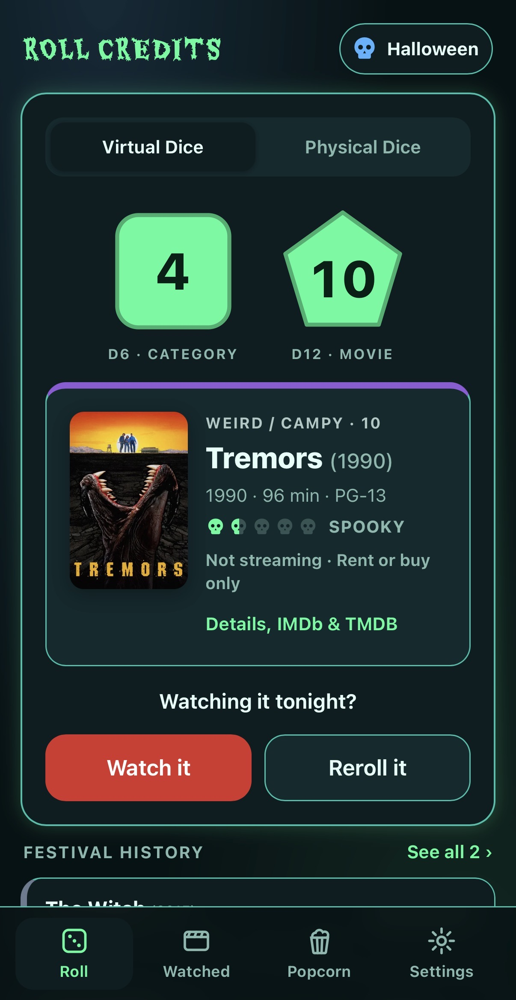
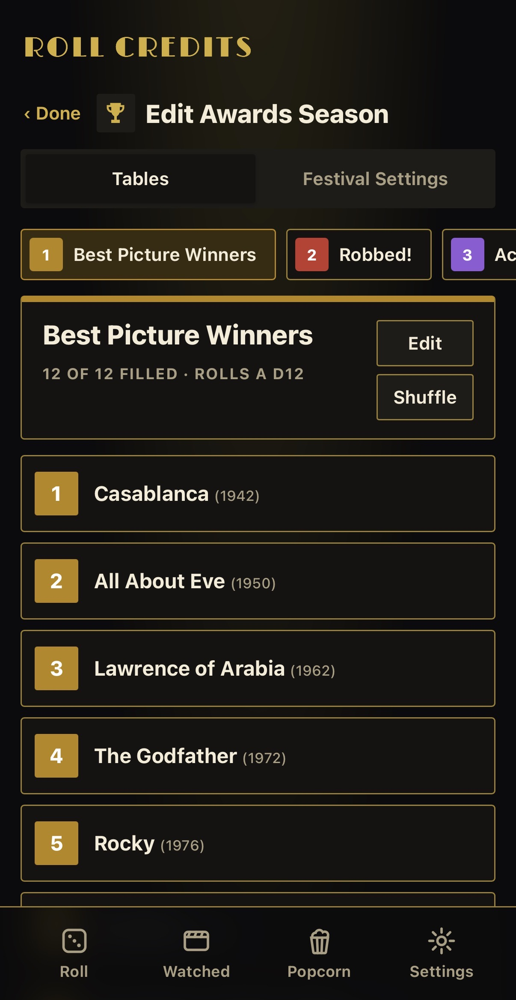
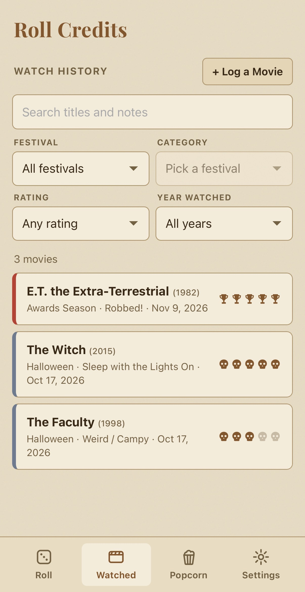
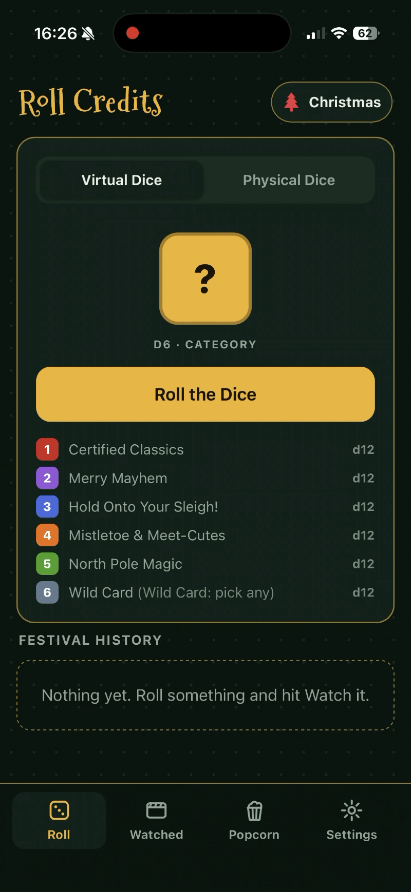
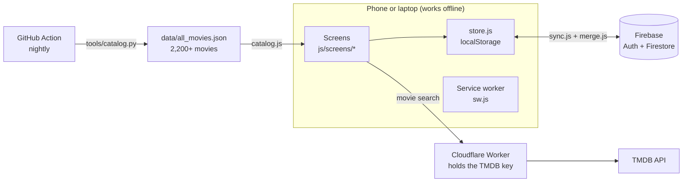

# Roll Credits

**Can't decide what to watch? Let the dice pick.**

Roll Credits turns movie night into a dice roll. Pick a film festival, roll one die for the category and another for the movie, and that's tonight's pick. No more scrolling for an hour.

**Open the app:** [blynch174.github.io/roll-credits-app-project](https://blynch174.github.io/roll-credits-app-project/)

It's free and runs in your phone's browser. Nothing to download from an app store.

*Here for the code? Skip to [How it's built](#how-its-built).*

&nbsp;&nbsp;&nbsp;&nbsp;

---

## Put it on your home screen

Roll Credits works best saved to your home screen, where it opens full-screen like a regular app and works offline.

- **iPhone:** open the link in Safari, tap **Share**, then **Add to Home Screen**.
- **Android:** open the link in Chrome, tap the **⋮** menu, then **Add to Home screen** (or **Install app**).

---

## How it works

1. **Pick a festival.** Each one is a themed set of movie tables with its own dice.
2. **Roll the first die** to land on a category, like *Slasher / Monsters* or *Sleep with the Lights On*.
3. **Roll the second die** to pick the movie from that category's table.
4. **Watch it**, or **Reroll it** if it's not the night for that one.

Rate it afterward and it goes in your watch history. Already seen the movie you rolled? Roll Credits can offer the next one in the series instead.

Got real dice on the coffee table? Switch to **Physical Dice**, roll them yourself, and type in what you got.

## Festivals

The app comes with a few to get you started:

| Festival | What's on it |
|---|---|
| **Halloween** | Five tables of horror plus a Wild Card, from *Light Halloween Fun* to *Sleep with the Lights On* |
| **Christmas** | Certified classics, rom-coms, North Pole magic, holiday action, and a little holiday horror |
| **Awards Season** | Oscar winners and nominees |
| **Kids & Family** | Picks for every age |
| **Bucket List Cinema** | Time Out's 100 best movies of all time, in rank order |

The **Festival Library** has more to add, like *Tear Jerkers*, *Boomer Classics*, and *Gen X Rewind*, with new ones landing over time. You can also **make your own festival** with your own categories, movies, and dice (up to 3 for now).

Every festival can be edited. Swap movies, rename categories, change the dice (coin, d4, d6, d8, d12, or d20), or start fresh when you've worked through it.

## More than dice

- **Popcorn Pick:** tap the popcorn bucket for one random movie from the whole catalog of 2,000+ films. Narrow it down by mood (Cozy, Unsettling, Witty, Heartbreaking…) or just let it surprise you. Save up to three for later.
- **Watch history:** everything you watch, with your rating and notes. Filter it by festival or year, fix the date or festival on any entry, or log a movie you watched without rolling for it.
- **Scare factor:** horror movies show how scary they are as five skulls (Mild, Spooky, Creepy, Scary, Terrifying), rated by today's standards.
- **Where to watch:** see which subscription and free services have a movie right now (US). Add **My Streaming Services** in Settings and Roll Credits points out the ones you already pay for, and Popcorn Pick can stick to them.
- **Themes:** 16 looks for the whole app, from Classic and Noir to Drive-In, Sci-Fi Terminal, Grindhouse, and Candy Cane.
- **3D dice (beta):** throw real-looking dice across the screen instead of the flat ones.

## Accounts (optional)

You don't need an account. Everything saves on your device and works offline.

Make a free account (just an email and password) if you want your festivals and watch history backed up and on more than one device. Changes sync automatically. If you edit on two devices, both sets of changes are kept.

With an account you can also:

- **Request a movie** that isn't in the catalog. Search TMDB for it when filling a slot or logging a movie, and admins review it for the next catalog update.

Found a bug or have an idea? **Settings → Send Feedback** (sign in first).

## Privacy

Your festivals, watch history, and settings stay on your device. If you make an account, they're also backed up with Google Firebase along with your email so you can use them on other devices. Nobody else can see them, and nothing is sold or shared.

Admins can see your email, when you last opened the app, and how many movies you've logged. **Delete Account** (Settings → tap your email) erases the backup and the account, and **Export Backup** gives you a copy of your data any time.

## How it's built

I built Roll Credits using both my own knowledge and some AI-assited building for the gaps (Claude), starting in October 2026. The reason for this was to truly understand and learn the structure of how web applications are built from the ground up, and learn from any mistakes and bugs. This was a personal project I have been toying with for the past couple years. It's a phone-first web app that works offline, with optional accounts that sync across devices. About 7,800 lines of JavaScript in 40 modules, with no framework and no build step.

| Part | What it uses |
|---|---|
| App | HTML, CSS, JavaScript (ES modules), installable web app (PWA) |
| Accounts and sync | Firebase Authentication and Firestore, with security rules that limit each user to their own data |
| Movie data | Python catalog tool (standard library only) that merges hand-curated moods and franchises with TMDB details and Oscar data |
| API key protection | Cloudflare Worker relay, so the TMDB key never ships in the page |
| Automation | GitHub Actions: tests on every push, catalog rebuild every night |
| Tests | Node's built-in test runner, no dependencies (`npm test`) |

### Design decisions

- **The device is the source of truth.** Everything reads and writes `localStorage`, so the app works the same with or without signal. The account is a backup that syncs in the background, not something the app waits on.
- **Sync merges item by item instead of overwriting.** If you edit on your phone and laptop while offline, a whole-document "last save wins" would throw one device's changes away. Instead, every festival, history entry, and saved pick carries its own change time, deletions are kept as tombstones for 120 days, and the two copies merge so the newest change to each item wins (`js/merge.js`).
- **Fair dice.** Rolls use `crypto.getRandomValues` with rejection sampling, which avoids the small bias that `% sides` introduces. A chi-square test checks this in CI.
- **Data from outside the device isn't trusted.** Imported backups and synced data get type-checked, trimmed, and size-capped before the app uses them, then upgraded through versioned migrations (v1 → v3), so a bad file can't break someone's app.
- **No framework.** The app is small enough that plain modules keep it fast on older phones, and there's nothing to build, so a push is the deploy.

### Tests

`npm test` runs 49 tests in about a second, on Node 20 and 22 in CI. They cover:

- **Sync merging:** newest edit wins, deletions stick, edits made after a deletion survive, inputs never change
- **Saved data:** first launch, upgrading v1 data, rejecting and repairing bad imports, watching, removing, and editing tables
- **Dice:** range, every face reachable, uniform distribution
- **Catalog:** title matching, search ranking, sequel lookups, mood suggestions
- **Repo checks:** every data file parses, festival lists point at real movies, and every module is in the offline file list

That last check failed the first time it ran: five modules had been added without being listed for offline use, which would have broken the app for anyone who opened it offline right after an update. It's fixed, and CI now stops it from happening again.

To run the app locally: `python3 -m http.server 8000`, then open http://localhost:8000. More detail is in [DEVELOPER.md](DEVELOPER.md).

## Credits

- Movie details and posters come from [TMDB](https://www.themoviedb.org/). This product uses the TMDB API but is not endorsed or certified by TMDB.
- Where-to-watch info comes from [JustWatch](https://www.justwatch.com/) through TMDB. Roll Credits is not endorsed or certified by JustWatch.
- 3D dice by [dice-box](https://github.com/3d-dice/dice-box) (MIT). Theme fonts from [Google Fonts](https://fonts.google.com/).
- Oscar data from [DLu/oscar_data](https://github.com/DLu/oscar_data).

Built by Brandon Lynch.

## License

© 2026 Brandon Lynch. All rights reserved. The code is public so testers can see how it works, but it isn't open source: please don't copy, reuse, or redistribute it without permission. See [LICENSE](LICENSE).

Found a security problem? See [SECURITY.md](SECURITY.md) and report it through **Settings → Send Feedback**.

---

*Want to see how it's built or run your own copy? See the [Developer Guide](DEVELOPER.md).*
